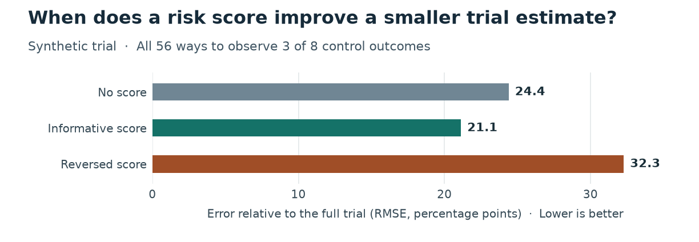

# Virtual Patient | Evaluating oncology trial models

**Hongrui Liu · Biomedical Sciences PhD candidate, Johns Hopkins University**

In a collaborative oncology project, I led the evaluation of a patient risk model. A review of the clinical source tables changed our first test. A scan date could tell us when a patient was examined, but some records lacked the evidence needed to establish when the cancer progressed. I kept those progression labels open for clinical review and designed a question we could test against survival follow-up: **among patients alive at day 84, did earlier blood tests help predict death by day 168?**

I specified who qualified, what information the model could use and what it had to beat. We compared it with both the group average and a simple measure of physical functioning. We kept patients with missing labs in the evaluation and examined their errors separately. [Read the clinical case study](docs/PROJECT.md) · [My role and the team's work](docs/CONTRIBUTIONS.md)

## Three examples you can inspect

| What I investigated | Inspect the evidence |
|---|---|
| **Clinical data quality.** Could a lab result actually have informed a prediction? A sample drawn before the cutoff may come back afterward. | [Six fictional timelines, with inclusion and outcome decisions](examples/WORKED_EXAMPLES.md#which-lab-was-available) · [Python implementation](landmark.py) |
| **Model evaluation.** How could calibration look stable as follow-up disappeared? In the synthetic example, the observed-to-expected event ratio stays at 1.073 from month 12 to month 18, while the number still under observation falls from 461 to zero. | [Calibration report](examples/REPORT.md) · [Survival calculation](demo.py) |
| **Trial design.** When could a risk score help recover a full trial's result from fewer control outcomes? I compared both methods on exactly the same control subsets and checked what happened when the score ranked risk in the wrong direction. | [Paired comparison and hand calculation](examples/WORKED_EXAMPLES.md#what-happens-with-fewer-controls) · [Replay code](control_subsets.py) |

### A trial-design decision in one figure



Even the informative score moved the estimate closer to the full-trial result in only **38 of 56** subsets. My proposed next step is to test whether a frozen score still ranks risk correctly in an independent trial before using it to adjust a treatment-effect estimate. These public examples use fictional records. [Exact calculation and assumptions](examples/WORKED_EXAMPLES.md#what-happens-with-fewer-controls)

## Reproduce the examples

Python 3.9+ and the standard library are sufficient. Run from the repository root:

```bash
python3 landmark.py
python3 control_subsets.py
python3 demo.py
python3 -m unittest discover -s tests -v
```

[Benchmark design](docs/BASELINES.md) · [Prediction and treatment-effect questions](docs/TASKS.md) · [Follow-up and censoring](docs/SUPPORT.md) · [Research decisions](docs/DECISIONS.md) · [Method references](docs/REFERENCES.md) · [Data and publication scope](docs/DATA_AND_PUBLICATION.md)
